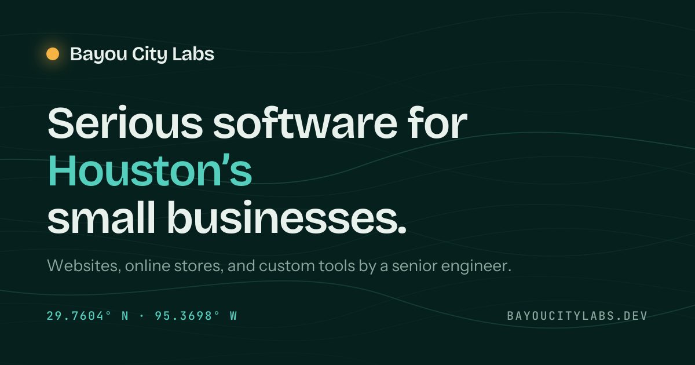

  

  <a href="https://bayoucitylabs.dev"><b>bayoucitylabs.dev</b></a>
  &nbsp;·&nbsp;
  <a href="mailto:hello@bayoucitylabs.dev">hello@bayoucitylabs.dev</a>
  &nbsp;·&nbsp;
  Houston, Texas

---

**Bayou City Labs** is a Houston web studio that builds websites, online stores, and custom software for small businesses. A senior full-stack engineer designs, builds, and ships everything, with no agency markup, no template mill, and no lock-in.

## What we build

| | |
| --- | --- |
| **Websites & storefronts** | Marketing sites, online stores, and booking flows that load fast, rank well, and stay easy for you to update. |
| **Web apps & custom tools** | Dashboards, client portals, and internal tools shaped around how your business actually runs. |
| **Audits & rescues** | Inherited a broken site or a build that stalled halfway? Performance audits, migrations, and getting it shipped without starting over. |

## How a project runs

1. **Scope it.** A real conversation about what your business needs, then a fixed scope and a fixed price before any code is written.
2. **Build in the open.** Working progress every week, not a big reveal at the end.
3. **Own it after.** Clean code, plain-language docs, and full access to everything. When it's done, the work is yours.

## In the open

| Project | What it is | Status |
| --- | --- | --- |
| [**freight-broker-toolkit**](https://github.com/Bayou-City-Labs/freight-broker-toolkit) | Automation for small freight brokerages: carrier vetting, load intake, and document generation. Next.js, TypeScript, PostgreSQL. | Early. Carrier vetting is built; load intake is next. |

Client work stays private by default. Clients own their repositories.

## Stack

TypeScript · React · Next.js · Node · C# / .NET · PostgreSQL

## Start a project

A new site, a stubborn bug, or a rough idea on the back of a napkin: email **[hello@bayoucitylabs.dev](mailto:hello@bayoucitylabs.dev)**. First reply within a day, and the first call is free.

<code>29.7604° N · 95.3698° W</code>
